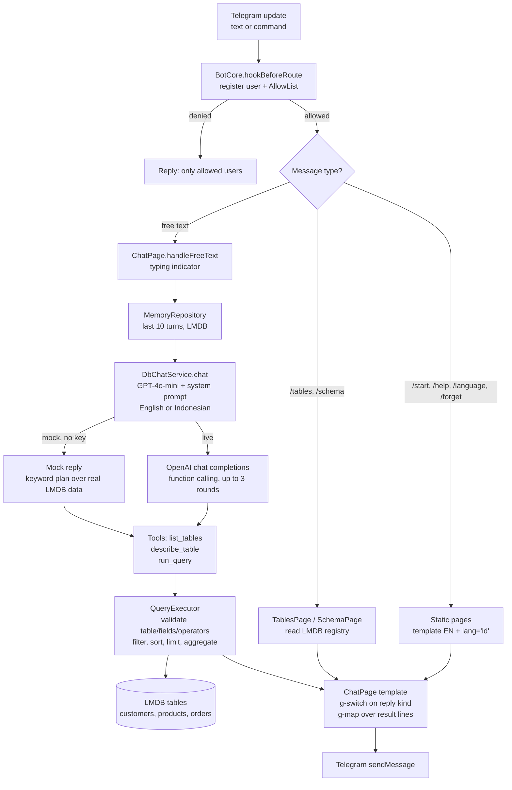

# bot-chat-database-lmdb-ai

A production-ready Telegram bot built with [Gramstax](https://github.com/gramstax/gramstax): declarative pages, template-driven messages, and end-to-end tested flows.

DB Chat lets you talk to your database in English or Indonesian. Send any question — no SQL needed. GPT-4o-mini turns it into a read-only query, the bot runs it against the database stored in LMDB, and answers you in the chat. It remembers the last 10 turns of your conversation.

The generated project is Bun-only: `gramstax start`, the test suite, and the build all run on Bun.


> 🚀 **Need a custom Telegram bot?** I build Telegram bots with Gramstax — text, voice, AI agents, and integrations, tailored to your workflow. Talk to me on Telegram: [@damartripamungkas](https://t.me/damartripamungkas).

## Features

- 🧩 **Page-based routing**: each screen is a class with `show`/`process` steps, inline keyboards, and session state
- 🎨 **Template engine**: rich HTML messages, filters, media groups, and multi-language variants
- 🗄️ **A real database, not a demo string**: customers, products, and orders live in LMDB, seeded on first run
- 🤖 **AI agent**: GPT-4o-mini with function calling — `list_tables`, `describe_table`, `run_query`
- 🔒 **Read-only by construction**: the agent emits structured queries (table + filters + sort + limit + aggregates). Raw SQL strings are never accepted, so nothing can write, drop, or delete
- 💬 **Persistent memory**: the last 10 turns per user survive a restart (LMDB window buffer)
- ✅ **E2E tested**: in-process harness asserts every Telegram API call (`e2e/` mirrors `src/pages/`)
- 🛡️ **Guards, throttling & metrics**: route guards, rate limits, and a status server out of the box

## Flow



## Quick Start

### 1. Install dependencies

```bash
bun install
```

### 2. Configure your environment

Edit `.env` (already created for you on scaffold) and set your bot token; get one from [@BotFather](https://t.me/BotFather). The CLI loads `.env` from the project root automatically; there is no `--env-file` flag to type and no `bun --bun` prefix.

```bash
BOT_TOKEN="123456:ABC-DEF1234ghIkl-zyx57W2v1u123ew11"
```

### 3. Run in development (watch mode)

```bash
bun run dev
```

### 4. Run in production

```bash
bun run start
```

Open Telegram, find your bot, and send `/start`.

## Commands

All commands are in English. Replies are bilingual — English by default, Indonesian when you pick it with `/language`.

| Command | What it does |
| :------ | :----------- |
| `/start` | Introduction and main menu |
| `/tables` | List all tables with row counts |
| `/schema <table>` | Columns of a table (example: `/schema orders`) |
| `/language` | Switch language (English / Indonesia) |
| `/forget` | Erase my memory of this chat |
| `/help` | Full help and command list |

Any other text goes straight to DB Chat. It remembers the last 10 messages of your chat.

## Try it out

The demo dataset is seeded automatically on first run — three tables:

| Table | Rows | Columns |
| :---- | :--- | :------ |
| `customers` | 12 | id, name, email, city, created_at |
| `products` | 10 | id, name, category, price, stock |
| `orders` | 16 | id, customer_id, product_id, quantity, total, ordered_at |

Ask the bot:

- "Which tables are available?"
- "How many orders are there?"
- "Total revenue by product?"
- "List customers from Jakarta"
- "Which products are out of stock?"
- "Describe orders"

To use your own data, replace the tables in `src/lib/seed.ts` (same shape:
name, description, columns with name/type, rows as plain objects) and
delete the database directory (`DB_PATH`, default `./data`) so the bot
reseeds on the next start. `/tables` and `/schema` always show exactly
what is stored — the schema registry is the tables themselves.

## Scripts

| Script          | Description                              |
| :-------------- | :--------------------------------------- |
| `dev`           | Start with file watching (`gramstax start --watch`) |
| `start`         | Start in production mode (`gramstax start`) |
| `build:gramstax`| Freeze pages into `.gramstax/`           |
| `typecheck`     | Type-check with `tsc --noEmit`           |
| `test`          | Run unit tests in `test/`                |
| `test:e2e`      | Run end-to-end tests in `e2e/`           |
| `test:e2e:check`| Run the mirror check + coverage ledger audit |
| `test:all`      | Run the e2e checks, then unit + e2e tests |

## Project Structure

```
├── AGENTS.md          # agent instructions for this generated app
├── gramstax.config.ts # Bot composition (token env name, deploy, caches): `gramstax start` boots from this file, no `src/index.ts`
├── src/
│   ├── base/          # Shared base classes (PageBase, GuardBase)
│   ├── blocks/        # Reusable keyboard block builders
│   ├── core/          # Bot entry (BotCore) and context (CtxCore)
│   ├── db/            # LMDB schemas + repositories (users, memory, tables)
│   ├── helpers/       # Domain helpers (logging)
│   ├── lib/           # App logic: config, OpenAI client, query executor, agent, seed data, language resolver
│   ├── pages/         # Bot screens: one file (or folder) per route
│   └── types/         # Shared types grouped by domain: user, dbchat, page
├── e2e/               # End-to-end tests (mirrors src/pages/) + COVERAGE.md ledger
├── test/              # Unit tests for pure logic
├── scripts/           # e2e mirror check + handler/ledger audit + structure generator
├── references/        # Original workflow file this project recreates (reference only)
└── data/              # LMDB data files (created at runtime)
```

Keep shared interfaces in `src/types/<domain>.ts` rather than declaring them
inline in a page or service.

New page? Create `src/pages/my-page.ts`, `e2e/my-page.test.ts`, and a row for every handler in `e2e/COVERAGE.md`. The mirror is enforced by `scripts/check-e2e-mirror.ts`; the handler/test ledger is enforced by `scripts/check-e2e-handlers.ts`.

## Configuration

All settings live in `.env` and are wired through `gramstax.config.ts` (`token` holds the token value via `process.env.BOT_TOKEN ?? ```, `deploy` and the session cache read their vars with local defaults). `gramstax start` and `gramstax build` load project-root `.env*` files automatically, with shell variables taking precedence:

| Variable                 | Required | Description                                                     |
| :----------------------- | :------- | :-------------------------------------------------------------- |
| `BOT_TOKEN`     | Yes      | Bot token from [@BotFather](https://t.me/BotFather)             |
| `BOT_DEPLOY`    | Yes      | `polling` (dev) · `webhook` · `serverless` (details in `optionsDeploy`) |
| `CACHE_SESSION_STORE` | No       | `memory` (single instance) or `redis:<url>` (multi-instance)    |
| `OPENAI_API_KEY` | No      | API key for live AI answers. Empty + default base URL = mock mode (deterministic answers from the real LMDB dataset); empty + custom base URL = live mode without a key (free providers) |
| `OPENAI_BASE_URL` | No     | OpenAI-compatible API base URL (default `https://api.openai.com/v1`) |
| `OPENAI_MODEL` | No         | Model name for the chat API (default `gpt-4o-mini`) |
| `DBCHAT_ALLOWED_IDS` | No  | Telegram ids allowed to use the bot, comma-separated. Empty = everyone allowed (dev mode) |
| `DB_PATH`       | No       | LMDB data directory (default `./data`)                          |
| `DBCHAT_MOCK_AI` | No      | `1` = force mock answers even with a key set (used by e2e)      |

### OpenAI-compatible providers

The bot talks to any OpenAI-compatible chat API — point `OPENAI_BASE_URL`
at the provider and set `OPENAI_MODEL` to the model name it serves. The
`Authorization` header is only sent when `OPENAI_API_KEY` is set, so
keyless free providers work too. A verified example is Pollinations:
`OPENAI_BASE_URL=https://text.pollinations.ai/openai` with
`OPENAI_MODEL=openai` (no key needed), which serves a free model and
supports tool calls.

## Testing

```bash
bun run test            # fast unit tests for helpers, stores, validation
bun run test:e2e        # full user journeys: /start → callbacks → free text
bun run test:e2e:check  # mirror check + every handler/test accounted for in e2e/COVERAGE.md
bun run test:all        # the checks, then everything, as CI runs it
```

E2E tests drive the real bot in-process (`deploy: test`) and assert every Telegram API call: message text, keyboards, media, edits, and call order. `e2e/COVERAGE.md` is the ledger: one row per handler, state, or hook-driven page, pointing at the test that proves it. The audit fails when a page handler or test file has no row.

## Deployment

- **Development**: `BOT_DEPLOY=polling`, then `bun run dev`.
- **Production (webhook)**: set `BOT_DEPLOY=webhook` and put your public URL in `optionsDeploy` in `gramstax.config.ts`, then run `bun run start` behind a process manager.
- **Serverless**: set `deploy` to `serverless` with `optionsDeploy` (`adapter` + `url`), run `bun run build:gramstax`, and deploy `.gramstax/server/` per the Gramstax serverless guide.

## Honest limitations — read before going live

- **No live AI without a key — unless you use a custom provider.** With the default base URL and no `OPENAI_API_KEY`, the bot answers from mock mode: deterministic, keyword-based answers computed from the real LMDB dataset. It never invents data, and it says nothing it did not read from the database. Set `OPENAI_BASE_URL` to a free OpenAI-compatible provider (see "OpenAI-compatible providers") and the bot runs live without a key.
- **The agent only knows the seeded tables.** It cannot query a database it was not given. To point it at your own data, replace the seed tables (see "Try it out") — there is no live Postgres/MySQL connector in this project.
- **Mock mode understands a fixed set of question shapes** (list tables, describe a table, count, revenue, list by city, stock). Anything else gets a short echo reply. With a live key, GPT-4o-mini handles free-form questions through the same tools.

## Planning with agents

If your agent supports project skills, copy the portable `gramstax-superplan` skill from the Gramstax repository into this project's `skills/` directory. It plans app work under `plans/NNN-feature-slug/plan.md`, reads this project's `package.json` scripts, and never edits `node_modules` or `.gramstax/`. For full coverage, also copy `gramstax-best-practices` and `lmdb-best-practices`; the planner routes to them.

## Tech Stack

- [Gramstax](https://github.com/gramstax/gramstax): declarative Telegram bot framework with template-driven pages
- [Bun](https://bun.sh): runtime, test runner, and bundler
- [TypeScript](https://www.typescriptlang.org): strict mode
- [@gramstax/lmdb](https://github.com/gramstax/gramstax): persistent storage — users, conversation memory, and the demo dataset
- [OpenAI](https://platform.openai.com): GPT-4o-mini for the agent (live mode only)

## Learn More

- [Gramstax Documentation](https://github.com/gramstax/gramstax)
- [Telegram Bot API](https://core.telegram.org/bots/api)

## License

MIT
